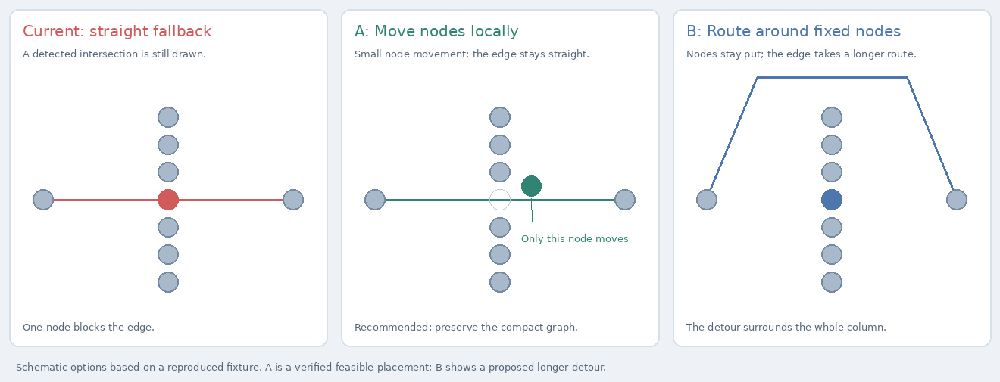

# Edge–node clearance repair design

Task identifier: `2026-10-16-edge-node-clearance`

Status: option A approved by the user on 2026-10-16; independent design review passed with no design-level blockers. Review clarifications are incorporated below.

Source and delivery target: `plugin/graph-workspace` at `0734fb23db6873f4ec64c3e3e29fc8c3e17edc7a`. All investigation and proposed changes are isolated in the PM integration worktree.

## Problem and goals

The user reports that Graph Workspace edges still intersect nodes. Existing correction and routing can detect an obstruction, fail to repair it, and publish a straight path through the obstructing node. The goal is to remove avoidable intersections while preserving the compact graph appearance, pins, node spacing, enclosure boundaries, deterministic layout, and bounded frame work.

The existing preference for moving nodes to untangle the graph informs the recommended option A. The screenshot's exact map has not been replayed; the investigation reproduces the same visible failure in a small fixture through the unchanged production correction and router.

## Reproduced causes

1. `EdgeConflictCorrection.relocate` returns immediately when complete initial detection finds more than eight conflict keys. This is an intentional performance policy introduced by commit `8139ab374f`, and the existing suppression test requires it. Eight independent edge–node conflicts are all repaired in one verification; nine independent conflicts receive zero verification attempts and require nine bowed edges.
2. `addEdgeOverNodeCandidate` generates one perpendicular displacement. It does not search the other side or add a small displacement along the edge. A clear placement may therefore exist without being offered to verification.
3. `EdgeRouter.route` publishes the original straight path when every detour fails or a routing budget expires. Its node-clearance predicate protects successful candidates, but does not protect that final fallback. `GraphPainter` draws the published samples directly.

Baseline validation: `EdgeConflictCorrectionShould` (38 tests) and `EdgeRouterShould` (23 tests) pass, with no failures or skipped tests.

Read-only diagnostic results using actual node radii from `GraphGeometryEngine`:

| Fixture | Initial edge–node conflicts | Relocation attempts | Final path through a node | Control |
| --- | ---: | ---: | ---: | --- |
| One independent obstruction | 1 | 1 | 0 | Existing simple repair works |
| Eight independent obstructions | 8 | 1 | 0 | All eight repaired as one batch |
| Nine independent obstructions | 9 | 0 | 0 | Router substitutes nine bows |
| Preferred side blocked | 1 | 1 | 0 | Other-side placement clears all conflicts and node gaps; current router uses a bow |
| Seven-node column across one edge | 1 | 1 | 1 | Moving the central node to `(25, 11)` clears all conflicts and node gaps |

Every initial diagnostic fixture has zero node-gap violations. The column's endpoints are `(-100, 0)` and `(100, 0)`; the column nodes are at x = 0 and y = `-66, -44, -22, 0, 22, 44, 66`, with radius 8. The diagonal control is an independently checked feasible placement, not an implementation of the repair algorithm.

## Visual options

- **A — Local node repair (recommended):** keep a straight edge by moving the obstructing unpinned node to a nearby verified clear position. Try a small deterministic set of alternatives on both sides and, when necessary, with a small displacement along the edge. Process bounded repair candidates even when total conflicts exceed eight.
- **B — Longer obstacle detours:** keep node positions and extend routing to travel around the obstructing cluster. This needs longer paths and larger bends than the current routing limits, and changes the graph's appearance more substantially.

The mockups are schematics based on the column fixture. A depicts a feasible placement checked against production conflict detection and node-gap validation. B depicts the proposed appearance of a longer detour; it is not current router output.

## Recommended architecture and data flow

Keep the existing sequence: layout engine → node/enclosure separation → edge-conflict correction → geometry rebuild → edge routing → published canvas.

Concentrate the behavior change in `EdgeConflictCorrection`:

- Replace the all-or-nothing eight-conflict suppression with bounded candidate selection from a complete detected conflict set. Preserve limits on indexing, pair checks, verification work, attempts, and rounds. Each attempted repair still requires complete whole-frame verification; selecting fewer conflicts does not make that verification local. Progress is required for the small in-budget acceptance fixtures, while larger frames may stop with no accepted move when verification cannot complete within the shared frame allowance. Budget exhaustion must retain the last completely verified positions and an honest residual rather than restart expensive scans.
- For an edge–node conflict, offer nearby clearances on both sides. If direct perpendicular moves fail, consider a small deterministic set of diagonal alternatives. Prefer smaller movements and use canonical keys and a stable ordering to break ties.
- Continue accepting only changes that reduce the conflict set without adding node-gap violations or sibling-hull violations. Keep active pins and enclosure anchors fixed.
- Publish and route using geometry rebuilt from the accepted positions. The test oracle checks every segment of the final published path against unrelated node discs, including fallback paths.

Implementation should reuse the existing candidate verifier and counted work limits. The technical specification will pin the finite candidate set, its order, numerical tolerance, and accounting before implementation begins.

## Constraints and unresolved geometry

Clearance is required for the repairable acceptance fixtures. The design does not promise that every pinned or constrained graph has a feasible straight drawing. If pins, boundaries, incomplete detection, or a work limit prevent a verified repair, preserve those constraints and retain the residual conflict; do not describe that frame as fully cleared. The broader question of a universal routing guarantee under impossible geometry is outside this local repair.

## Verification and acceptance

First add failing regression tests for nine independent repairable conflicts, a blocked preferred side with a clear opposite side, and the column fixture with a clear diagonal placement. Each must require accepted local node movement, correction of the intended edge–node conflicts, and straight final paths; zero rendered intersections alone is insufficient because the first two fixtures currently use clear bows. Check every final path segment against unrelated discs from the same rebuilt geometry, including the three-world-unit clearance with an explicit tolerance, and require every expected visible edge to be present. At least the column regression must inspect an actually published `CanvasState` through the existing publication seam.

Then verify active pins, enclosure boundaries, minimum node gaps, deterministic output under reordered input, and all counted work caps. Existing crossing-repair and routed-attachment tests remain applicable. Replace the obsolete test that requires skipping every crowded frame with assertions for bounded progress and bounded cost.

Run the complete graph-plugin suite and relevant performance gates. Preserve the committed A7a workload, its strict thresholds, and its zero-exhaustion rule. The introducing commit recorded an unresolved three-second A7b failure; baseline reconciliation commit `8d11991533b9be9414fec0fae6729805ee3ba9fe` subsequently set the active complete-frame bound to five seconds. The new specification must identify that active baseline and must not relax it. Record and compare baseline failures before attributing a regression. Capture real application evidence of the corrected fixture after implementation, alongside measurements of the final paths.

## Approval and next phase

The user approved option A on 2026-10-16 with “I approve it!” in response to the explicit option-A approval question. The selected visual is the local-node-repair panel; option B is not selected. Independent design review passed with no design-level blockers or new user decisions. Its budget qualification, stronger regression assertions, final-publication witness, and current performance pins are incorporated above. The PM now drafts and independently reviews the technical specification, and presents that specification for final sign-off before autonomous implementation planning and execution.
