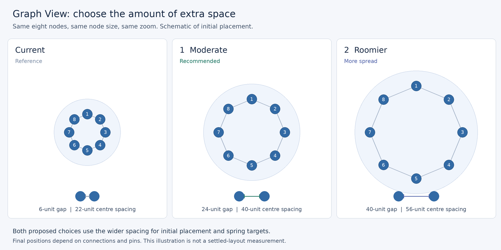

# Graph View — wider initial and preferred node spacing

- Date: 2026-10-16
- Task identifier: `graph-initial-spacing`
- PM run: `pm-run-20261016-125451-a5048653`
- Delivery target: `plugin/graph-workspace`
- Base: `0734fb23db6873f4ec64c3e3e29fc8c3e17edc7a`
- Status: user-approved design, option 1 — Moderate (24-unit preferred gap); independent design review PASS, round 2.

## User decision and intended result

The user reports that nodes initially cluster too closely together. They selected
**B: widen initial placement and the settling layout's preferred spacing**. The
layout should open with more space between nodes and continue aiming for that
wider spacing as it settles.

This extends the scope beyond the 2026-10-13 cluster-proximity design's
initialization-only decision for this new node-spacing change. That earlier
work's compact enclosure packing remains the basis of the layout.

## Visual options



| Variant | Preferred edge gap | Centre distance for two radius-8 nodes | Trade-off |
| --- | --- | --- | --- |
| Current reference | 6 units | 22 units | Crowded starting point |
| **1 — Moderate (recommended)** | **24 units** | **40 units** | Clear increase with a smaller workspace footprint than option 2 |
| 2 — Roomier | 40 units | 56 units | More breathing room and a larger workspace footprint |

Both proposals implement scope B. The illustration uses the existing ring formula
for eight equal radius-8 nodes at the same zoom and draws an indicative group
envelope. It is a design schematic, not an application screenshot or a measured
settled result. The separate two-node rulers show each gap directly.

The user selected **option 1 — Moderate** after choosing scope B. The approved
preferred gap is **24.0 layout units**. Option 2 remains in this comparison only
as an unselected design alternative; it is not a runtime mode.

## Approaches considered

1. **One preferred node gap shared by layout targets (recommended).** Introduce a
   layout-owned constant of 24 units and use it in the existing content
   ring and relationship rest-length formulas. Existing footprints and hierarchy
   distances derive from those values. This gives one parameter with a narrow
   change surface and retains the current layout algorithms.
2. **Multiply all preferred distances.** A common multiplier also widens the
   graph, but scales distances due to large node radii and enclosure size as well
   as the empty space. Its effect varies more with prominence and nesting.
3. **Add an adjustable density preference.** This permits personal tuning but
   adds UI, persistence, and live-update behavior to a request for a better
   default. A fixed, reviewed default addresses the present request directly.

## Architecture and data flow

Keep the change within `GraphStreamLayoutEngine`'s existing parameterized
geometry. The approved constant is `PREFERRED_NODE_GAP = 24.0`.

For an enclosure with at least two direct nodes, retain the existing ring formula:

```
R = (2 * maximumRenderedDiscRadius + PREFERRED_NODE_GAP)
    / (2 * sin(pi / directNodeCount))
```

For zero or one direct node, retain a zero ring radius. With mixed prominence,
the maximum rendered radius continues to give conservative spacing. The same
computed ring radius feeds all existing consumers:

- `Seeds.nodePosition` for new node positions;
- `BoundarySizes.placements` for the content footprint and recursive enclosure
  packing;
- containment spring rest lengths so their targets match the wider ring;
- enclosure endpoint radii when relationship rest lengths are computed.

Relationship springs use `firstEndpointRadius + secondEndpointRadius +
PREFERRED_NODE_GAP`. This is necessary for connected nodes to receive a wider
preferred distance too. It applies to both same-map and cross-map relationships;
force coefficients and the existing cross-map motion budget stay as they are.
Hierarchy spring lengths continue to come from the resulting packed anchor
positions.

`NodeSeparationProjection.MIN_GAP = 6.0` remains the hard collision clearance.
The preferred gap describes a layout target, while that lower bound remains a
separate geometry constraint. Remove the engine's now-unused dependency on the
collision constant if these are its only uses. There is one active preferred-gap
parameter and no legacy preference fallback.

## User-visible behavior and scope

Fresh Graph View layouts and **Reset Layout** seed the wider node rings and
targets. Larger content footprints flow into compact enclosure packing, allowing
groups to accommodate their expanded contents. Keep the existing 8-unit packing
gutter between enclosure footprints.

Healthy **Restart Layout** resumes retained particle coordinates with the wider
targets. Failed-layout recovery keeps its existing worker-recreation behavior.
Ordinary projection synchronization preserves retained positions, seeds added
particles using the current deterministic scheme, and rebuilds affected targets
without forcing retained nodes onto a new ring. Active pins retain their exact
coordinates throughout; a pair of pins can force closer spacing than the
preference. Exact fresh-ring gaps are not promised for incremental additions or
healthy restart.

This change adds no setting, menu item, serialization field, or migration. Node
radii, label placement, zoom policy, projection semantics, and the force model
remain governed by their existing mechanisms.

## Settling contract and limitations

The wider value remains in the force targets on every synchronization and reset;
it is not discarded after initial seeding. The final distance is an equilibrium
among containment, relationships, repulsion, hull corrections, and pins. The
preferred gap is not a guarantee that every settled pair has exactly 24 units of
clearance, and the schematic must not be presented as a settled measurement.

The settled acceptance frame is the **first non-failed corrected `LayoutWorker`
frame whose `idle().idle()` is true**, under the unchanged production idle policy
(eight consecutive frames within its RMS and maximum motion thresholds). It
must be reached within **2000 worker steps and 30 seconds per fixture**. Failure,
timeout, or no idle blocks acceptance; the last budget frame can only be reported
as diagnostic evidence. Do not substitute the older cluster probe's endpoint of
first idle plus 200 additional steps.

Compare baseline and candidate on three required fixed unpinned cases: direct
nodes without relationships, a same-map relationship case, and a cross-map
relationship case. Each case has at least one enclosure with two or more direct
nodes. Use identical workspace IDs, projection order, calibration, prominence,
metrics, and zoom in the two versions. Freeze the exact fixtures and baseline
provenance in the technical specification before implementation.

For every node in each qualifying enclosure, compute its nearest-neighbor
rendered disc-edge gap within that enclosure:

```
nearestGap(i) = min(distance(i,j) - renderedRadius(i) - renderedRadius(j))
               over the other direct nodes j in the same enclosure
```

At first idle, the median of those per-node gaps in **every qualifying enclosure
of every required fixture must increase by at least 6.0 layout units**, with a
numerical tolerance of 1e-6. At the fixed acceptance zoom of 1.0 this is a
6-pixel visible-improvement margin. Report each enclosure's minimum as well as
its median; retain the existing collision, residual, pin, and painted-crossing
safety assertions. Measure relationship-endpoint gaps separately, with their
24-unit preferred rest gap verified directly. Enclosure/anchor distances alone
do not satisfy the node-spacing gate.

Record the next 100 worker frames' node gaps and idle/motion diagnostics as a
separate post-idle experiment. Those frames cannot replace a failed first-idle
comparison or be described as the application's stopped frame. Real-application
fixed-zoom evidence must identify the actual first-IDLE state. If a required case
cannot satisfy the gate with the approved parameter change, revisit the design
before claiming the user's intended outcome has been achieved.

## Error handling and edge cases

The new default is a finite positive internal constant, so it introduces no new
input parsing or failure path. Existing validation and force-failure handling
remain in force. Cover empty, singleton, two-node, mixed-prominence, nested, and
multi-map projections; connected and unconnected nodes; pins; restart; and
retained particles after a topology update. Wider geometry must remain finite
and deterministic.

## Verification strategy

1. Pin the preferred gap with independent expectations for the initial two-node
   and multi-node distances; include mixed prominence and singleton behavior.
2. Verify that containment and relationship spring rest lengths use the selected
   preference, including node and enclosure relationship endpoints. A change
   confined to initial seeding must fail these tests.
3. Verify that expanded content footprints participate in sibling and top-level
   packing without overlap, while the packing gutter remains 8 units.
4. Execute the first-idle gate above for the required relationship-free,
   same-map, and cross-map fixtures. Assert the declared 6-unit per-enclosure
   median improvement, bounded convergence, and existing safety invariants;
   report relationship-endpoint gaps and the separate 100-frame diagnostic
   window. Do not infer settled behavior from target lengths alone.
5. Re-run the affected layout, boundary, separation, pin, determinism, and canvas
   tests. Preserve existing displacement and safety assertions unless evidence
   requires a separately reviewed change.
6. Capture real-application initial and settled views at the same zoom for the
   delivered change, including a nested/multi-map example and pin behavior.
7. Run the required plugin and project checks before final audit and delivery.

Baseline evidence, before any application changes: the original run of
`BoundaryFootprintShould` and `ClusterPackingShould` had 25 passes and one timeout
at the existing 5-second await. The isolated rerun reproduced it and logged
`Authorization required, but no authorization protocol specified`. Investigation
found that the test JVM inherited an unauthorized X11 display; font measurement
runs on the layout worker and AWT initialization errors can leave the submitted
future incomplete.

The same original two-class command, with only
`JAVA_TOOL_OPTIONS=-Djava.awt.headless=true` added, passed **all 26 tests**, with
200-enclosure submission at **0.565 seconds** against the unchanged 3-second
assertion. The isolated headless test also passed. No production code, test code,
or deadline changed. The baseline is clear in headless mode. Preserve that test
environment for non-UI checks; actual UI evidence requires a valid display.
Original and diagnostic logs are retained in the external PM run's `reports/`:
`baseline-spacing.log`, `baseline-packing-isolated.log`,
`baseline-packing-headless.log`, and `baseline-spacing-headless.log`.

## Acceptance criteria

- The approved visual default is option 1, with a 24-unit preferred edge gap.
- On a fully fresh or reset engine seed frame, adjacent unpinned equal-radius
  direct nodes in every enclosure with at least two direct nodes have a 24-unit
  disc-edge gap within numerical tolerance. Mixed prominence uses the maximum
  rendered radius conservatively; empty and singleton behavior is unchanged.
  Incremental updates and healthy restart verify retained-coordinate continuity
  and updated targets instead of exact fresh-ring gaps.
- Both containment and relationship target lengths use the selected wider
  spacing throughout settling and after reset.
- The three required unpinned cases pass the first-idle gate: idle within 2000
  steps and 30 seconds, at least 6 units of median nearest-neighbor gap
  improvement in every qualifying enclosure, and existing safety assertions.
  The separate 100-frame post-idle window is reported honestly.
- Compact enclosure packing accommodates the wider contents; safety, pins,
  retained-particle continuity, and finite geometry checks pass.
- Required validation passes in the documented headless environment, including
  the existing 3-second packing assertion; no failed gate is waived or weakened.
