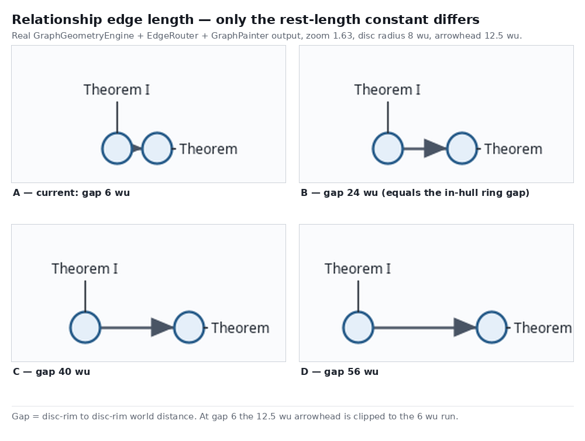
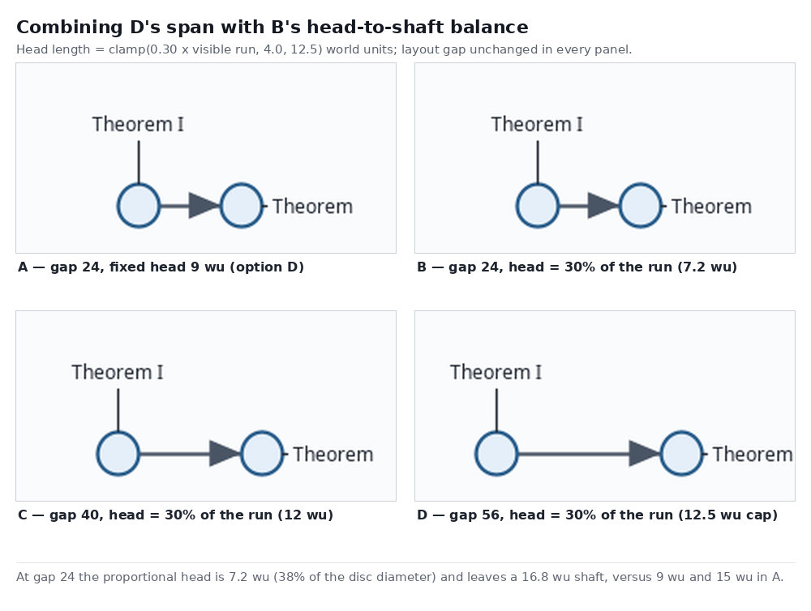
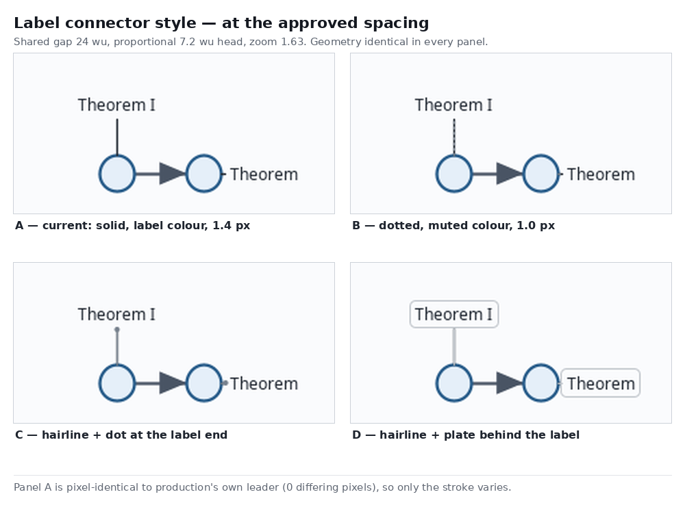

# Graph edge length and label connector design

Task identifier: `2026-10-23-graph-edge-length-and-label-connector`

Status: approved by the user on 2026-10-23. The user chose the spacing as a combination of
options B and D from the arrowhead comparison — option D's compact span (the shared gap stays
24 wu) with option B's head-to-shaft balance (a proportional head) — and connector option **B**
for the label indicator. Both choices are recorded with their mockups below.

Source and delivery target: `plugin/graph-workspace` at
`448c0d679d2b1d46563eaf079352e1eefb254305`. All investigation, mockup rendering and proposed
changes are isolated in the PM integration worktree; the delivery checkout was only read.

## Problem and goals

The user reports two defects in the Graph Workspace canvas:

1. "The default edge length still looks too short; only the arrow is visible. It is even shorter
   than the line used to indicate the node name."
2. "Please use a different style for the name/type indicator; otherwise, it looks like an edge."

The user clarified the second report with a cropped screenshot: the element under complaint is the
connector joining a label to its node disc — not the label text. In the screenshot the displaced
label above a disc is joined by a solid vertical stroke, and the labels placed to the right of
discs are joined by short solid horizontal strokes. Both read as relationship edges.

Goals:

- A relationship edge is visibly a line with an arrowhead at its end, never an arrowhead alone,
  at any gap, zoom, or node prominence, for single and double-headed edges.
- At the reported fit zoom of 1.63, every relationship edge run is longer than the connector
  attached to either of its endpoints. The run is world-space (`gap × zoom` = 39.1 px) while
  connector placement is screen-space: a displaced leader is `DISPLACED_OFFSET - LEADER_CLEARANCE
  = 27 px` and the longest diagonal displaced leader measured in the existing suite is 30.645 px.
  The inequality therefore holds for zoom ≥ 30.645 / 24 ≈ 1.28, not at zoom 1 as a bounded claim
  would require; below that crossover the run shrinks with the world while connectors do not, and
  this design accepts that pre-existing consequence of screen-space label placement.
- A label connector reads as an annotation, not as a graph relationship.
- Within one enclosure, relationship springs never demand more room than the containment ring
  already provides. This is a local claim; section C1 states exactly where it does and does not
  hold.
- No change to hull sizes, node radii, prominence, label placement geometry, zoom policy,
  persistence, pins or projection semantics.

Non-goals: arrowhead shape, hull stroke weights, label font ladder, connector *geometry* (leader
start/end placement, slot selection, clearance), and the hull stroke tiers.

Scope note: the connector restyle applies to **every** label connector, node labels and enclosure
labels alike, because `GraphPainter.paintLabels` paints both from one loop. Enclosure label leaders
therefore become dotted and muted too. Their text styling, font, slot selection and clamped
`labelColor()` text paint are unchanged.

Amended 2026-10-23 after the first frontier design review: the frozen `graph-initial-spacing`
acceptance harness must itself be amended (D1), the arrowhead rule gained a shaft guarantee (C2),
the connector-length goal was corrected to the measured crossover (Goals), the ring argument was
restricted to its provable scope (C1), enclosure-label connectors were brought explicitly into
scope, and the production/test inventory and performance evidence were completed.

## Reproduced causes

All values below are read from the delivery base at `448c0d679d`, and layout units are model
coordinates.

**Cause 1 — the relationship rest length is a collision clearance, not a preferred length.**
`GraphStreamLayoutEngine.topology` builds each relationship spring as

```text
restLength = radius(first) + radius(second) + NodeSeparationProjection.MIN_GAP
```

with `MIN_GAP = 6.0` and `NODE_RADIUS = 8.0`. For two default nodes that is `8 + 8 + 6 = 22`
centre-to-centre, so the drawn line between the two disc rims is exactly **6 wu**. The earlier
`graph-initial-spacing` work raised `PREFERRED_NODE_GAP` to 24.0, but that constant feeds only
`BoundarySizes.contentRingRadius` for enclosure rings; relationship springs still use `MIN_GAP`.

**Cause 2 — the arrowhead is a fixed 12.5 wu and is clipped to the run.**
`GraphPainter.paintArrow` computes `effectiveArrowHeadLengthPx(zoom, available)` as
`min(ARROW_HEAD_WORLD_LENGTH * zoom, available * zoom)`. With `ARROW_HEAD_WORLD_LENGTH = 12.5` and
a 6 wu run, the head is clipped to 6 wu and **fills the entire edge** — the arrow *is* the line.
At the reported screenshot's zoom (disc diameter 26 px, so zoom ≈ 1.63) that is a 9.8 px run and a
9.8 px head. The head base is `0.42 × length × 2 = 10.5` wu against a 16 wu disc: **66% of the
disc diameter**, which is why the head reads as the dominant element even when a shaft exists.

**Cause 3 — the label connector is drawn with the relationship stroke.**
`GraphPainter.paintLabels` draws the leader line with `theme.labelColor()` and
`leaderStroke(theme, zoom)`, whose width is `edgeStroke.getLineWidth() / zoom` — the same 1.4 px
solid stroke, same cap and same join as a relationship edge, in a near-identical colour. Light
theme: `labelColor = (31, 38, 48)` versus `edgeColor = (73, 84, 100)`. Nothing but colour
distinguishes "this stroke points at a label" from "this stroke is a relationship".

Measured consequence at the reported zoom: the edge run is 9.8 px while the connector above it is
27 px, which is exactly the user's "shorter than the line used to indicate the node name".

## Visual options and approved choices

The mockups below are rendered from the real pipeline — `GraphGeometryEngine` → `EdgeRouter` →
`GraphPainter` — compiled against the delivery base with the candidate constants passed in. Two
fidelity controls were asserted: when the current style is selected, the connector panel is
pixel-identical to production's own leader rendering (**0 differing pixels**), and when the fixed
12.5 wu head is selected the arrow panel is pixel-identical to production's own head (**0 differing
pixels**). Only the decision under test varies between panels.

### Edge length options (background)



Disc-rim to disc-rim gaps of 6 (current), 24, 40 and 56 wu with today's fixed head. This set
established the constraint that decided the outcome: the gap is not a free parameter. An enclosure
ring places adjacent members `2·maxR + G` apart, so raising `G` multiplies hull size, and
`GraphCanvas.fitGraph()` then divides the zoom by the larger world span — the discs shrink on
screen by the same factor. Gap 24 is the only value that needs no hull growth at all, because it
is already `PREFERRED_NODE_GAP`.

### Approved spacing — gap 24 with a proportional head



The user asked to combine option B's balance with option D's span, where B was "gap 56 with a 9 wu
head" and D was "gap 24 with a 9 wu head" in the preceding arrowhead comparison. Because the gap
multiplies the hulls while the head-to-shaft ratio does not, the combination is reached on the head
dial. Panel letters below are local to this image and do not refer back to that comparison:

- **A** — gap 24, fixed 9 wu head (option D as first shown).
- **B** — gap 24, head = 30% of the run = 7.2 wu. **Approved.**
- **C** — gap 40, head = 12 wu; the same ratio at a larger span.
- **D** — gap 56, head = 12.5 wu; the ratio rule reaches today's cap, so the head never grows.

The approved point keeps `PREFERRED_NODE_GAP` at 24.0, so hull size, fit zoom and disc size are
unchanged from the delivery base, while the relationship edge is lengthened 22 → 40 wu
centre-to-centre and the head drops from 65.6% to 37.8% of the disc diameter. Panel B of this image
is the approved spacing; it is the combination of the earlier B and D, not either of them alone.

### Approved label connector



Rendered at the approved spacing. **Option B — dotted, `mutedColor`, 1.0 px — approved.**

Option A is today's behaviour: a continuous stroke in `labelColor` at the relationship weight, the
line that reads as an edge. Option C (hairline plus an endpoint dot) is a viable second choice.
Option D (a plate behind the text) was rejected because the plate fills with `theme.background()`,
which would punch a canvas-coloured hole through an enclosure fill; making it correct there needs a
hull-tinted fill and more design than this change warrants.

## Approved architecture and exact change set

The approved design touches three production sites and adds no new class. Both defects are fixed
by construction rather than by tuning: the relationship spring is bounded by the containment ring,
and the arrowhead is bounded by the run it sits on.

### C1 — relationship springs use the preferred gap, bounded by the ring

In `layout.graphstream.GraphStreamLayoutEngine.topology`, the relationship `ForceLink` rest length
becomes:

```text
gap  = (edge.first is a node AND edge.second is a node) ? PREFERRED_NODE_GAP : NodeSeparationProjection.MIN_GAP
rest = radius(first) + radius(second) + gap
```

`PREFERRED_NODE_GAP` stays `24.0`. `NodeSeparationProjection.MIN_GAP` stays `6.0` and remains the
minimum clearance used by `NodeSeparationProjection`, `EdgeConflictCorrection` and the
hull-endpoint rest length. Containment and hierarchy rest lengths are untouched.

Why enclosure endpoints keep `MIN_GAP`: a hull endpoint's "radius" is already its content ring,
which encodes the preferred spacing. Adding the preferred gap there would place the node a further
24 wu outside its own ring, so the relationship spring would pull against the containment spring
that holds it on the ring. Keeping the additive gap node-only avoids double counting.

Why this cannot fight the ring, and where it can: for two direct members of **one** enclosure, each
radius is at most `maxR`, so `rest = r₁ + r₂ + G ≤ 2·maxR + G`, and `2·maxR + G` is exactly the
chord between adjacent ring members, by construction of `contentRingRadius`. The bound holds with
mixed prominence too: radii 8 and 14 give `rest = 46` against a chord of `52`. This is a property to
assert, not a tuning result.

The bound is **local**. It does not constrain, and this design does not claim it constrains:

- node-to-node pairs in different enclosures, different maps, or no enclosure at all, where no
  ring exists to bound them;
- a node that is a direct member of more than one enclosure, which receives one containment link
  per membership (`GraphStreamLayoutEngine.java:248`) while only one seed parent is recorded;
- pinned nodes, whose position does not respond to the spring at all;
- node-to-anchor pairs, where `rest = R + r + MIN_GAP > R` holds today and is deliberately left
  unchanged by C1;
- settled (as opposed to seeded) geometry: `restLength` is a force target, so the equilibrium of
  a mixed-prominence or cross-map graph moves even though no seed formula changed.

D2 below turns those exclusions into measurements instead of assumptions.

### C2 — proportional arrowhead

In `canvas.GraphPainter`:

```text
ARROW_HEAD_RATIO              = 0.30
MIN_ARROW_HEAD_WORLD_LENGTH   = 4.0
MAX_ARROW_HEAD_WORLD_LENGTH   = 12.5      (replaces ARROW_HEAD_WORLD_LENGTH)
MAX_ARROW_HEAD_RUN_FRACTION   = 0.50       (shaft guarantee)
ARROW_HEAD_HALF_BASE_RATIO    = 0.42       (unchanged)
```

`effectiveArrowHeadLengthPx(zoom, available)` becomes
`min(clamp(0.30 · available, 4.0, 12.5), 0.50 · available) · zoom`, keeping the existing clipping by
the terminal segment. The `arrowAtFirst && arrowAtSecond` halving of `available` is unchanged, as is
the bow handling; `paintArrow` keeps using the same unit vectors and half-base ratio.

The `0.50 · available` term is what makes the goal hold rather than merely improve. Without it the
4.0 wu floor would still let a 3 wu run be drawn as a 3 wu head with no shaft, and a double-headed
edge would be all head. With it the head never exceeds half of the run available to it, so a shaft
of at least half the run always survives — for a single head and, after halving, for each head of a
double-headed edge.

Piecewise head length by terminal availability `a`, monotone and continuous:

| `a` (wu) | head (wu) |
| --- | --- |
| `a < 8` | `0.50 · a` |
| `8 ≤ a < 13.33` | `4.0` |
| `13.33 ≤ a < 41.67` | `0.30 · a` |
| `a ≥ 41.67` | `12.5` |

Consequences at the approved spacing: a 24 wu run gets a 7.2 wu head (30% of the run, base 6.05 wu
= 37.8% of the disc); a run of 41.67 wu or more keeps today's 12.5 wu head, so long edges are
pixel-identical to the base; a 6 wu run gets a 3 wu head and leaves a 3 wu shaft where the base drew
a 6 wu head with no shaft at all. For a double-headed edge the thresholds apply to `distance / 2`,
so the base 12.5 wu head is reached at an 83.33 wu separation rather than at 41.67 wu.

The now-unused `arrowHeadLengthPx(zoom)` helper is deleted rather than left as a second head-length
entry point, per the repository's legacy-removal policy.

### C3 — dotted, muted label connector

In `canvas.GraphPainter`:

- `paintLabels` draws the leader with `theme.mutedColor()` and sets the paint colour back to
  `theme.labelColor()` before `drawCentered` paints the text, in that order, inside the existing
  per-label loop. This applies to every label in the loop, node and enclosure alike.
- `leaderStroke` becomes `leaderStroke(zoom)` — the theme parameter is removed because the colour
  is now chosen at the call site — and returns
  `new BasicStroke(w, CAP_ROUND, JOIN_ROUND, 10.0, {1.2/zoom, 2.8/zoom}, 0.0)` with
  `w = max(1.0/zoom, MIN_STROKE_WORLD)` and `MIN_STROKE_WORLD = 1e-6`.

Dividing width and dash lengths by `zoom` keeps the connector a 1.0 px hairline with a 4.0 px dash
pitch at ordinary zoom, exactly as the current stroke keeps a constant screen width. The
`MIN_STROKE_WORLD` clamp exists because `GraphViewport` accepts any finite positive zoom: at an
extreme zoom such as `1e46` the quotient underflows to zero when converted to `float`, and
`BasicStroke` rejects an all-zero dash array. The clamp keeps the stroke constructible across the
whole accepted zoom domain; its visual effect starts only where a world unit is already below a
millionth of a device pixel.

Leader *geometry* (`ScreenLabelPlacement`, `LeaderLine`) is untouched, so hit-testing, retained
placement and the existing geometry tests are unaffected.

The dash pattern is applied only to the leader. The arrowhead is filled, never stroked, so
`ARROW_HEAD_HALF_BASE_RATIO` is never applied to a dotted stroke; the multiplicity cue keeps its own
font and `labelColor()` paint and is unaffected. Because the leader inherits the label's existing
dim-unrelated alpha, a dotted line at 0.28 opacity over a tinted hull is the lightest case the
design admits, which is why the test plan samples light theme, dark theme, over a hull fill and
under dimming.

Light theme `mutedColor = (120, 130, 142)` against `labelColor = (31, 38, 48)`; dark theme
`mutedColor = (151, 163, 178)` against `labelColor = (240, 244, 248)`. The connector therefore loses
both the edge's colour and the text's weight, which is what makes it read as an annotation.

## Invariants

| Id | Invariant |
| --- | --- |
| I1 | Every relationship link whose endpoints are both nodes has `restLength = r₁ + r₂ + 24.0`, where `r` is the disc radius from `radiusById`. |
| I2 | Every relationship link with at least one enclosure endpoint has the same `restLength` as the delivery base. |
| I3 | For any two direct members of **one** enclosure, the relationship `restLength` is `≤ 2·maxR + 24.0`, the ring chord. Cross-enclosure, cross-map, multi-membership and pinned pairs are excluded from this invariant by design. |
| I4 | Containment and hierarchy rest lengths are unchanged. |
| I5a | For every painted arrowhead, `length ≤ min(12.5, 0.50 · availableRun)` and `length ≥ min(4.0, 0.50 · availableRun)` at every zoom. |
| I5b | For every painted edge, single- or double-headed, a shaft of at least `0.50 · availableRun` remains uncovered by any head. |
| I6 | An edge whose terminal availability after the double-headed halving is `≥ 41.67` wu paints the same head as the delivery base; for a double-headed edge that means a separation `≥ 83.33` wu. |
| I7 | Head half-base remains `0.42 × length`, and the head is filled, never stroked. |
| I8 | The leader stroke paints 1.0 screen px wide with a 4.0 screen px dash pitch across the accepted zoom domain, and its dash array is never all-zero, including at extreme zooms such as `1e46`. |
| I9 | Label text is painted in `theme.labelColor()`; every leader, node or enclosure, is painted in `theme.mutedColor()`; the text paint is restored after the leader. |
| I10 | `ScreenLabelPlacement` leader geometry is unchanged. |
| I11 | At zoom 1.63 every relationship run between two default nodes (`24 × 1.63 = 39.12` px) exceeds the longest connector the placement fixtures produce (`30.645` px). |
| I12 | The frozen `graph-initial-spacing` C0 control remains reproducible byte-for-byte; only the candidate overlay allowlist and the `node-node` rest target are amended. |

## Test strategy

Production-scale unit tests, in the existing modules and naming style:

1. `GraphStreamLayoutEngine` — I1, I2, I3, I4. Fixtures: two default nodes; a mixed-prominence
   pair (radii 8 and 14, so `rest = 46` against a chord of 52); a pair inside a four-node
   enclosure comparing `restLength` against the `BoundarySizes.contentRingRadius`-derived chord;
   the existing cross-map fixture, which already contains enclosure endpoints, asserting those
   links are unchanged (I2); a node that is a direct member of two enclosures, asserting it is not
   claimed by I3 but that its containment links are unchanged (I4).
2. `GraphPainter` — I5a, I5b, I6, I7 over terminal availabilities
   `{3, 6, 8, 13.33, 24, 41.67, 80}` at zooms `{0.25, 1, 1.63, 4}`, for a single-headed and a
   double-headed straight edge. Assert the head geometry in world units, not device pixels, plus
   one device-pixel probe at zoom 4 proving the fold into `paintArrow`. The `3` and `6` rows carry
   the report's own scenario: they assert that a shaft survives, which the base does not do.
3. `GraphPainter` — I8, I9, I10. A pixel probe over the leader segment asserting `mutedColor`-near
   ink with gaps (the dotted pattern must produce both ink and non-ink samples along the segment)
   and `labelColor`-near ink in the text box, repeated for light theme, dark theme, over a hull
   fill and under dim-unrelated alpha; a geometry assertion that `PlacedLabel.leader()` is
   unchanged; a construction assertion that `leaderStroke` is legal at zoom `1e46`.
4. `GraphPainter` — I11 as a render-measured comparison: place a default two-node edge and a
   displaced label at zoom 1.63 and assert the measured run exceeds the measured connector.

Existing tests that must change, and why:

| Test | Change |
| --- | --- |
| `GraphCanvasPaintShould.keepsTheLeaderStrokeScreenConstant` (`:1021`) | Assert 1.0 screen px and a `{1.2, 2.8}` dash array after `× zoom`, instead of equality with the 1.4 px edge stroke. |
| `GraphCanvasPaintShould.paintsTheLeaderStrokeScreenConstantThroughTheProductionCallSite` (`:1030`) | Detect leader ink with `mutedColor`, and count ink across the whole segment rather than one column, because a single column can land in a dash gap. |
| `GraphCanvasPaintShould` head-rule probe (`:1398`–`:1405`) | `effectiveArrowHeadLengthPx(0.6, 6.0)` becomes `2.4` and `(1.0, 3.0)` becomes `3.0`; add the new shaft-guarantee rows. |
| `GraphCanvasPaintShould.capsTheArrowheadAtTheTerminalSegmentOfARoutedPath` (`:1594`) | The expected 30 px head becomes 12 px, and the historical `12.5 / 8.68 ≈ 1.4401` crossover comment is replaced by the new piecewise rule. |
| `ScreenLabelPlacementShould` (`:1736`) | Migrate the helper that calls `GraphPainter.leaderStroke(theme, zoom)` to the new `leaderStroke(zoom)` signature, or it will not compile. |
| `InitialSpacingConsumers.topology` (`:179`–`:180`) | Node-to-node links assert `first + second + 24.0`; links with an enclosure endpoint keep `+ 6.0`. |
| `InitialSpacingSeedShould` (`:14`, `:26`, `:33`) | The `+ 6.0`-based relationship assertions move to the new gap; its `PREFERRED_NODE_GAP == 24.0`, ring and `contentRingRadius` assertions stay as they are. |

### D0 — committed UI evidence

`GraphWorkspaceUiEvidence` writes the committed screenshots used by earlier specifications. It
asserts canvas, toolbar and interaction behaviour and contains **no** `labelColor`, `mutedColor` or
leader-pixel assertion (verified by search), so C2 and C3 cannot fail it and regenerating it is not
required for correctness. It is regenerated anyway, once, because the committed images would
otherwise depict the old head and connector; the regeneration is recorded as evidence, not asserted
by a test.

### D1 — the frozen `graph-initial-spacing` acceptance harness must be amended

This is not optional and it is the first review's blocker. `InitialSpacingAcceptanceShould`
(`src/test/java/.../layout/graphstream/InitialSpacingAcceptanceShould.java:14`) spawns
`src/test/resources/initial-spacing/run-initial-spacing.py` in fresh JVMs and asserts its exit
status, so the driver runs inside the ordinary `freeplane_plugin_graph` suite. The driver:

- pins **every** production source under `freeplane_plugin_graph/src/main/java/` against the C0
  blob plus an explicit overlay allowlist (`run-initial-spacing.py:65`–`:87`), with
  `assert current == expected, 'Unexpected production difference'`. C1 edits
  `GraphStreamLayoutEngine.java`, which is `ENGINE` in that allowlist, so the run fails unless the
  overlay list is extended by exactly this change;
- pins the `REST` matrix targets (`run-initial-spacing.py:289`): `nn = 22.0` for both C0 and
  candidate. C1 makes the candidate `nn` value `40.0`.

The amendment, in the same commit as C1:

1. Extend the driver's `ENGINE` overlay with exactly the C1 topology substitution, in the same
   literal-replace form the existing overlays use, so the frozen C0 bytes stay the control.
2. Change the `nn` target tuple to `(22.0, 40.0)`. Leave `ne = 42.28427124746190` and
   `ee = 62.568542494923804` unchanged: they are `R + r + MIN_GAP` and `R + R + MIN_GAP`, and C1
   deliberately does not touch enclosure-endpoint links. That triple is itself the test that C1
   stayed node-to-node.
3. Regenerate and archive a fresh receipt set (`manifest.json`, `results.json`, `verification.json`,
   `comparison.json`, `acceptance.md`, `raw/*.json`) under
   `freeplane_plugin_graph/doc/initial-spacing/runs/`, exactly as the previous feature archived
   its runs, and keep the frozen C0 archive untouched (invariant I12).
4. Keep every C0 assertion, the seed-gap matrix and the control-pair accounting intact; only the
   candidate overlay and the `nn` target change. The `graph-initial-spacing` **acceptance values**
   (24.0 seed gaps, `contentRingRadius == 20.0` in `BoundaryFootprintShould:73`) are genuinely
   unchanged; it is the harness's production-diff pin and its `nn` rest target that change, which
   the first version of this design wrongly described as "untouched".

### D2 — performance and settle evidence

The existing performance gate cannot measure this change. `SettledReferenceFixture` is a committed,
SHA-256-pinned ledger of fixed coordinates and `SettledReferenceFixtureCompiler` runs no
relaxation, so `GraphWorkspacePerformanceDiagnostic:892` measures the cost of processing a frozen
geometry, not the equilibrium this change moves. That gate is retained as a **regression** gate
(it proves the routing and conflict pipelines were not made slower), and a separate, fresh
candidate relaxation measurement is required:

- first-idle step count and wall time, per fixture, C0 versus candidate;
- settled node–node, node–enclosure and enclosure–enclosure gap minima and medians, to show that
  C1's longer relationship rests do not shrink any recorded gap;
- edge–node and edge–edge conflict counts at first idle and after 100 further frames;
- routing work per published frame.

Fixtures: the existing relationship-free reference, S1, cross-map and mixed-prominence fixtures,
plus one nested three-level enclosure fixture, which the existing set does not cover. This mirrors
the evidence procedure the `graph-initial-spacing` feature used, and it is where findings 4 and 7
of the first review are answered with numbers rather than with an assumption.

Verification gates, in order: the full `freeplane_plugin_graph` suite (which includes the amended
D1 harness), then D2, then the retained replay regression gate.

## Risks

1. **The frozen spacing harness changes.** The `graph-initial-spacing` driver's production-diff pin
   and its `nn` rest target must be amended (D1), so part of a previously accepted feature's
   evidence is rewritten. The C0 control stays byte-identical, and the amendment is one overlay
   plus one target value, but it is a real edit to accepted evidence and must be reviewed as such.
2. **Settled geometry moves.** Rest length 22 → 40 changes where unpinned nodes come to rest, so
   recorded settle snapshots, idle-step counts and conflict counts may change. The ring bound only
   proves that *same-enclosure* pairs do not gain conflicting demand; cross-map, nested and pinned
   pairs are unconstrained. Mitigation: D2 measures first-idle, settled gaps, conflicts and routing
   work on five fixtures instead of assuming them.
3. **Longer paths cost more routing work.** Longer edges cross more cells and can raise edge–node
   and edge–edge checks per frame. Mitigation: D2 measures it; no new budget is introduced.
4. **Thin dotted connectors on dense maps.** A 1.0 px muted dotted stroke is lighter than today's
   solid line, and under dim-unrelated alpha over a tinted hull it is the lightest case the design
   admits. Mitigation: the connector is screen-constant, the test plan samples the four extreme
   combinations, and option C (hairline with an endpoint dot) remains available if the dotted form
   proves too light in practice.
5. **The connector stays longer than the edge below zoom ≈ 1.28.** This is the one part of the
   user's original complaint that the approved spacing does not remove: at 24 wu, the run is 24 px
   at zoom 1 while a displaced connector is 27 px, and the longest diagonal displaced connector
   measured in the existing suite is 30.645 px. At the reported fit zoom of 1.63 the run is 39.1 px
   and the goal holds. If the low-zoom case matters, the follow-on lever is shortening
   `DISPLACED_OFFSET`, which is label geometry and therefore out of scope here.

## Out of scope

Arrowhead shape or direction; the multiplicity cue; hull stroke weights and tiers; the label font
ladder and truncation; connector geometry, clearance and slot selection; node radius, prominence
and separation; persistence and workspace XML; pins.
